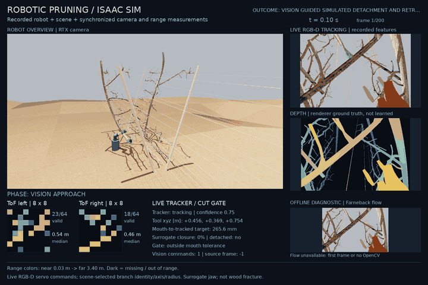
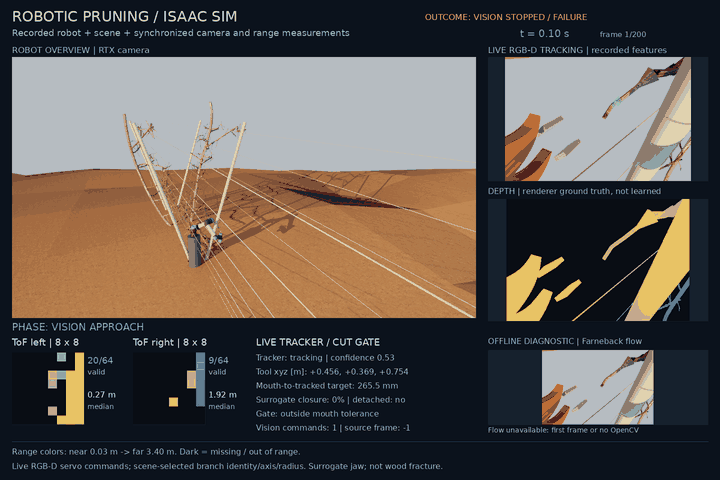
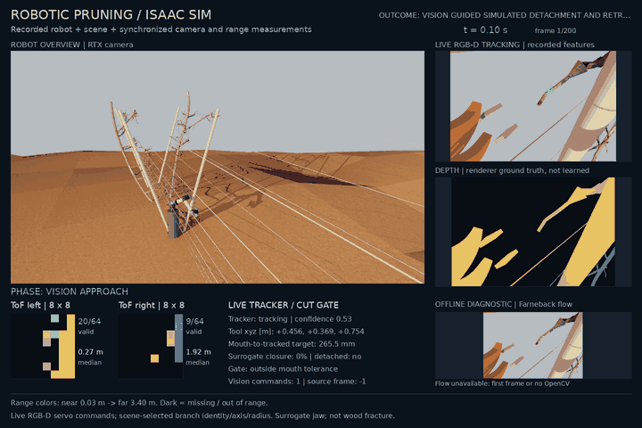
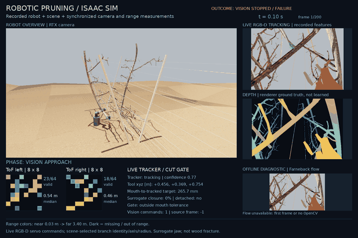
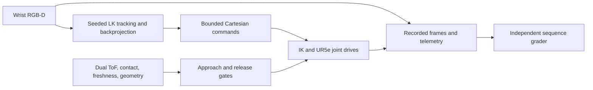

# Vision-Guided Pruning in Isaac Sim

**A simulated UR5e that tracks a branch, gates its approach and release, and records enough evidence to check what happened.**

I built the RGB-D controller, dual-ToF/contact gates, recording pipeline, and independent sequence grader. Controlled lighting and occlusion studies expose where the system works and where it stops.

[](https://github.com/joses2017smjh/isaac-sim-pruning-workflow/releases/download/isaac-vision-2026-09-13/isaac_two_trees_vision_sequence.mp4)

*Selected 20-second simulation: one known target, 17/17 sequence checks. Release uses a discrete rigid-piece surrogate; the jaws do not model wood fracture.*

[Replay studio](https://joses2017smjh.github.io/isaac-sim-pruning-workflow/) · [Visual case study](https://jose-sanchez-portfolio-com.vercel.app/projects/isaac-pruning-workflow/) · [Wrist-camera video](https://github.com/joses2017smjh/isaac-sim-pruning-workflow/releases/download/isaac-vision-2026-09-13/isaac_two_trees_vision_sequence_wrist.mp4) · [Detailed results](docs/RESULTS.md)

## Problem and contribution

A thin branch can disappear behind a closing tool. Low-sun shadows can also look like tracking failure even when the branch stays still. A convincing animation alone cannot establish whether the robot used valid observations or released at the right moment.

This workflow links perception, bounded commands, release gates, and recorded telemetry. A separate grader checks the sequence instead of trusting the renderer's success label. Robot and orchard assets are pinned upstream inputs; [NOTICE.md](NOTICE.md) records their provenance.

## Evidence at a glance

| Experiment | Recorded result | What it establishes |
| --- | --- | --- |
| Selected baseline sequence | **17/17 checks**, 68 vision commands, release at 7.8 s | Inspectable behavior on one known target. [Artifact](docs/evidence/two_tree_summary_2026-09-14.json) |
| Low-sun agreement variant — Oct. 4 | Target 14944 passed **4/4** trials; jaw/wire occlusion controls still stopped | Depth-consistent shadows can be accepted under this modified confidence gate. [Protocol](docs/EVAL_PROTOCOL_AGREEMENT_ARM_CLOSED_LOOP_2026-10-03.md) |
| Closure hold on new targets — Oct. 5 | **0/9** runs reached closure | The known-target pass did not establish generalization. [Protocol](docs/EVAL_PROTOCOL_HOLD_GENERALIZATION_2026-10-04.md) |
| ROS 2 software replay | **199/199** recorded decision states reproduced; max command delta **1.995 mm** | Agreement on recorded simulation, not hardware validation. [Method](docs/ROS2_SIL.md) |

Population failures remain published: the original 40-trial study had no completions, including 20 invalid registrations. Later studies passed 2/7 listed targets and 1/30 seeded targets; those populations and modified gates are not pooled. [All results and visual comparisons](docs/RESULTS.md).

**Latest artifact audit — October 14:** the October 6 closure-hold batch now has stored recordings, but capture-exit flags and the full preregistered verdict remain unresolved. The ROS 2 node source evaluated by the October 6 DDS receipt is now public (October 15 update). [Flags, hashes, and scope](docs/ARTIFACT_AUDIT_2026-10-14.md). Neither audit establishes hardware performance.

## Watch the control decisions

### Same evening target: stop, then depth-agreement pass





*October 4 study, target 14944: the modified gate accepts a depth-consistent shadow; genuine occlusion controls still stop. These selected clips use simulator ground-truth depth. The four targeted passes are not a population success rate. [Protocol and controls](docs/EVAL_PROTOCOL_AGREEMENT_ARM_CLOSED_LOOP_2026-10-03.md).*

### Keep the closure failure visible



*Separate recorded attempt: tracking is lost during closure, and release is withheld. This is not the same-target lighting comparison above.*

## How it works



Initial branch identity, axis, and radius come from mesh metadata. Tracking then uses classical Lucas–Kanade and simulator optical-Z depth. Dual 8×8 ray-cast ToF sensors and contact checks condition approach and surrogate release.

| Source | Responsibility |
| --- | --- |
| [Environment](source/isaaclab_pruning/isaaclab_pruning/sim/pruning_env.py) | Scene, robot, sensors, and surrogate release |
| [Controller](source/isaaclab_pruning/isaaclab_pruning/sim/vision_demo_controller.py) | Vision commands and control state |
| [Capture](hpc/inner/render_pruning_workflow.py) / [grader](tools/validate_vision_sequence.py) | Record evidence; check ordering, commands, closure, motion, retreat, and return |
| [Depth check](source/isaaclab_pruning/isaaclab_pruning/perception/depth_appearance.py) / [jaw model](source/isaaclab_pruning/isaaclab_pruning/perception/jaw_self_mask.py) | Separate surface changes from lighting and known jaw occlusion |

## Engineering decisions and tradeoffs

- **Retain failed runs.** Stop reasons and raw telemetry remain part of the evaluation record.
- **Check depth consistency before relaxing appearance.** This helps with shadows but currently depends on privileged simulator depth.
- **Report modified gates separately.** Known-map plans, exact jaw poses, and closure holds change available information. Holds waive freshness and frame-reuse checks on held frames.
- **Evaluate learned depth independently.** Offline lighting training improved rendered-tree depth, but Isaac wrist-camera error remained above 0.5 m. Learned depth does not drive this controller. [Study](docs/EVAL_PROTOCOL_LIGHTING_TRAINING_2026-09-27.md) · [Renderer control](docs/EVAL_PROTOCOL_RENDER_GAP_2026-09-30.md).

## Run the portable CPU demo

Requires Git, Python 3.10+ with `venv`, and Linux or macOS. This demo uses ideal tool motion and synthetic sensors; it does not reproduce the Isaac footage.

```bash
git clone --branch develop https://github.com/joses2017smjh/isaac-sim-pruning-workflow.git pruning
cd pruning
python3 -m venv .venv
.venv/bin/python -m pip install torch --index-url https://download.pytorch.org/whl/cpu
.venv/bin/python -m pip install -e 'source/isaaclab_pruning[demo,dev,render]'
.venv/bin/python tools/run_pruning_demo.py --output-dir demo-output
```

Open `demo-output/pruning_demo.html` to inspect the replay and sensor frames. Keep its generated HTML, GIF, and JSON together. [CPU demo guide](docs/DEMO.md).

```bash
.venv/bin/python -m pytest -q -m 'not isaacsim_ci'
```

[CPU CI](.github/workflows/foundation.yml) runs lint, formatting, tests, and demo generation. [ROS 2 CI](.github/workflows/ros2.yml) exercises the software replay. Neither certifies a fresh GPU setup or physical operation.

## Isaac setup and scope

GPU captures require the pinned Isaac Sim 6.0.0.1 / Isaac Lab 3.0.0b2 stack and external robot/orchard assets. Follow the [capture guide](docs/ISAAC_RENDER.md), [stack lock](docs/ISAAC_STACK.md), and [HPC guide](docs/HPC.md). The repository also publishes the replay studio through [GitHub Pages](.github/workflows/pages.yml).

This is a simulation study. Branch recognition is seeded, cutting mechanics are absent, and targeted passes do not establish orchard-wide reliability or continuous contact safety. Next work is broader target evaluation, layout/collision planning, and physical sensor calibration. [Current work](docs/PENDING.md).

**Stack:** Python, OpenCV, NumPy, Isaac Sim / Isaac Lab, USD / PhysX, ROS 2 Humble, C++17, Blender, PyTorch for offline studies, Slurm / Apptainer, pytest, and GitHub Actions.

Jose Sanchez · [Portfolio](https://jose-sanchez-portfolio-com.vercel.app/) · [GitHub](https://github.com/joses2017smjh)
