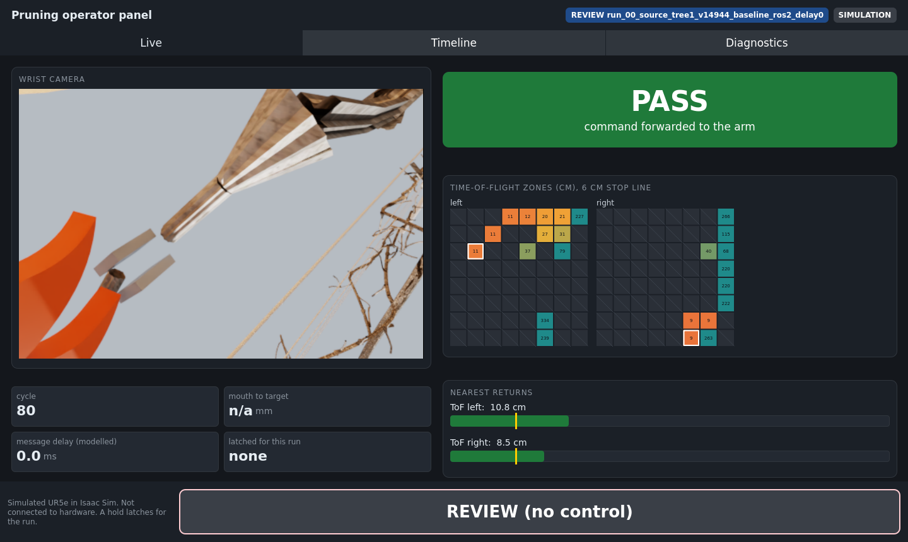
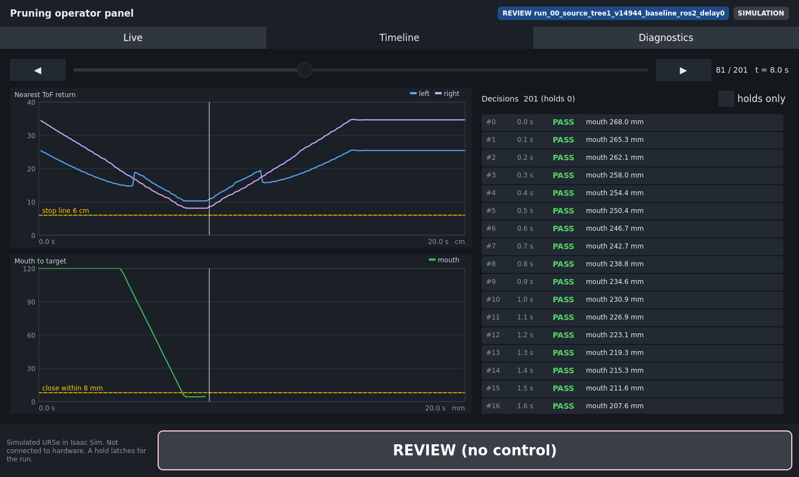
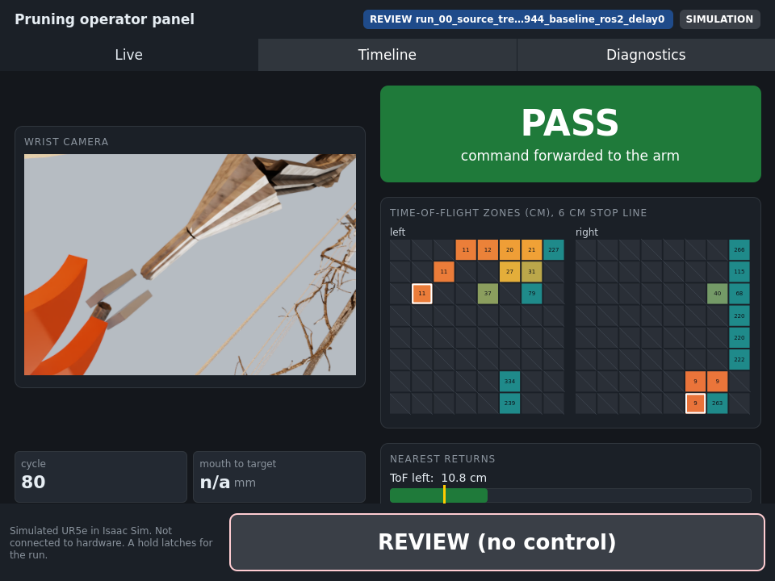
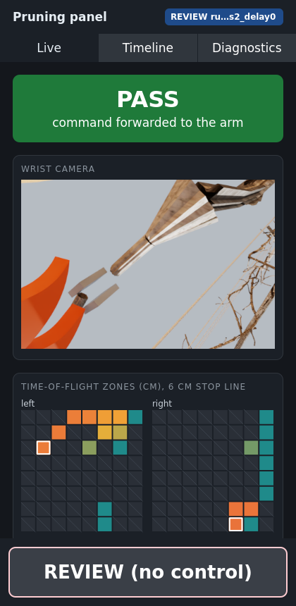
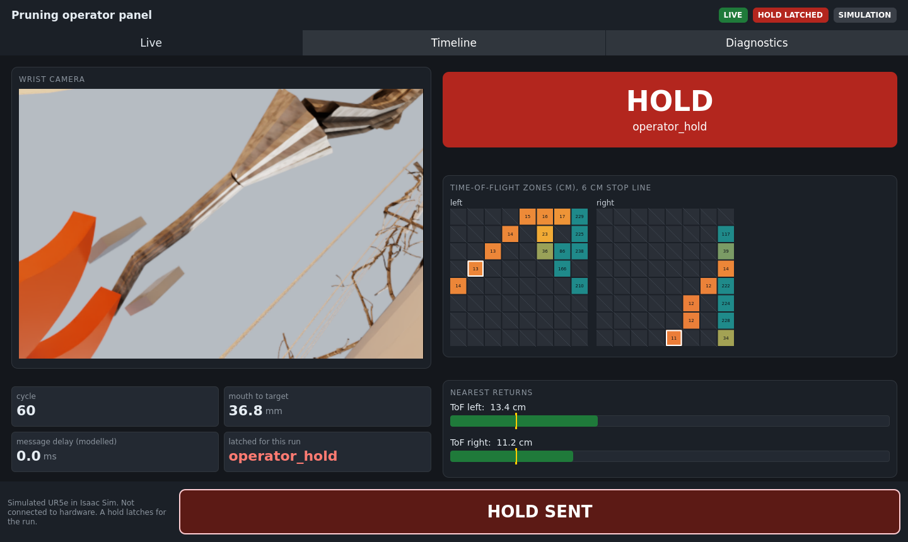
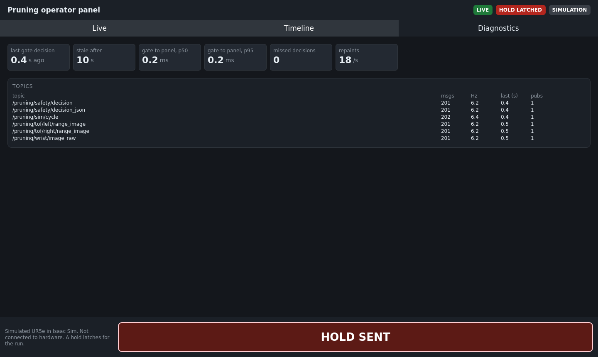

# Operator panel (Qt/QML) — November 5, 2026

`ros2/pruning_operator_panel` is a desktop app for watching the live pruning loop
and stopping it. It shows what the C++ safety gate decided and why, how the run is
unfolding, and whether the panel itself is keeping up. Its Hold button stops the
simulated arm. A C++ backend (an `rclcpp` node, Qt models, custom painted items)
feeds a QML front end built from design tokens and reusable components.



| Timeline | Medium (960 px) | Compact (420 px) |
|---|---|---|
|  |  |  |

These screenshots are review mode opened on cycle 80 of a recorded live-loop run
(`ros2-loop-delay-20261105`, run 0, 0 ms delay), in which ROS 2 drove the simulated
UR5e. The cut has just happened, so the target has left view and the mouth distance
reads n/a.

### Live over ROS 2: Hold and diagnostics

| After its own Hold button | Diagnostics |
|---|---|
|  |  |

These two come from the CPU rehearsal: the panel, the controller and the C++ safety
gate running live over ROS 2 on a replayed 14944 capture. The panel clicks its own
Hold button after 60 decisions. The gate held the next cycle with reason
`operator_hold`, and no passing decision followed. The panel showed 201/201
decisions and received 201/201 wrist frames, missed none, and saw gate-to-panel
latency of 0.2 ms at p50 and p95 (same node). The replay is open loop: recorded
poses keep moving after the hold. In the live Isaac loop, the arm stops.

## Pages

- **Live:** the wrist camera; a PASS / HOLD / STALE banner with the gate's reason;
  each ToF sensor's 8×8 zones as a heatmap (centimetres, the nearest zone outlined,
  zones under the 6 cm stop line outlined red); nearest-return bars against the stop
  line; cycle, mouth distance, modelled delay and the reason latched for the run.
- **Timeline:** both sensors' nearest return against the stop line, and the
  mouth-to-target distance against the 8 mm closing tolerance, with holds shaded.
  Every decision is listed (all or holds only). In review mode a slider, the arrow
  keys or a click on a row scrubs the run.
- **Diagnostics:** time since the last gate decision and the stale threshold,
  gate-to-panel latency (p50 and p95), missed decisions (gaps in the gate's cycle
  numbers), repaints per second, and per topic: message count, rate, age and
  publisher count.

## Design system

| Layer | What it is |
|---|---|
| Tokens | `qml/Theme.qml`, a singleton holding colour roles, a spacing scale, radii, a type scale, breakpoints and the Hold button's minimum touch target. Components use tokens, never literals. |
| Components | `StatusBanner`, `MetricTile`, `SectionCard`, `HoldButton`, `RangeBar`, `DecisionList`, and the C++ items `TimeSeries` and `ZoneGrid` (module `Pruning.Panel`). |
| Pages | `LivePage`, `TimelinePage`, `DiagnosticsPage`, composed in `main.qml` with a header (mode, stale and latched chips), tabs and a footer. |

**Responsive layout.** The window picks a layout mode from the width:

| Mode | Width | Layout |
|---|---|---|
| wide | ≥ 1180 px | Two columns (camera 48 %, status and sensors the rest); Timeline puts charts and the decision list side by side |
| medium | 760–1179 px | Two columns on Live; Timeline stacks charts above the list |
| compact | < 760 px | One scrolling column with the call first, then the camera, then the sensors |

At every size the Hold button sits in a footer outside every scroll area, keeps a
64 px minimum height, and answers to Space.

Column widths come from the page width, not from what the layout hands back. That
avoids the binding and re-layout loops Qt Quick Layouts report when a child's
height depends on a width the same layout assigns. The panel runs with no such
warning.

## Architecture

- **Threading.** The `rclcpp` executor spins on its own thread. Callbacks never touch
  QML objects: each hands its data to the GUI thread with a queued
  `QMetaObject::invokeMethod`, where models and properties change.
- **Models and items.** `DecisionLogModel` (a `QAbstractListModel`) is filtered by
  `HoldFilterModel` (a `QSortFilterProxyModel`) into a `ListView`. `SeriesStore` feeds
  `TimeSeriesItem`; `ZoneGridItem` paints the zone heatmaps. Both are
  `QQuickPaintedItem`s, so they render the same on the OpenGL and the software
  backends (the batch jobs run offscreen on software).
- **Safety semantics in the UI.** A STALE state outranks PASS: a screen that keeps
  showing the last PASS after the gate went quiet would be lying. A hold latches
  for the run with no remote release, as every gate stop does, and review mode
  cannot send one.
- **Qt and ROS together.** Qt keywords are compiled out (`QT_NO_KEYWORDS`), so
  `signals`, `slots` and `emit` cannot collide with ROS headers. The panel uses
  `Q_SIGNALS`, `Q_SLOTS` and `Q_EMIT`.

## Review mode

```bash
operator_panel --review artifacts/vision_robustness/ros2-loop-delay-20261105/run_03_..._ros2_delay6
```

This opens a recorded live-loop run with no ROS graph. It loads the gate's decision
log (`ros2_loop_decisions.jsonl`), the per-frame ToF grids from `frames.json`, and the
wrist images, then scrubs them. It is the quickest way to see why a run failed. In
the 100 ms runs, the Timeline shows the approach stretching out until the episode
ends during the retreat.

## Measured, not asserted

The panel writes a JSONL record (`--record`) of every decision and camera frame it
receives and applies, every repaint with the decision it was showing, and every
Hold press. The live-loop protocol scores two claims from that record and the
gate's own log ([R4–R5](EVAL_PROTOCOL_ROS2_LIVE_LOOP_2026-11-05.md)):

- **It keeps up.** Every gate decision is received, every pass/hold change is
  repainted before the next decision arrives, and every wrist frame arrives.
- **Hold works.** From the press to the simulator applying the first held
  command, in wall-clock milliseconds on one node and in control cycles.

`--auto-hold-after-cycles N` synthesizes a mouse click on the QML Hold button after
N decisions, so a headless run exercises the real button and its handler.

## Tests

`test/test_panel_model.cpp` (gtest, offscreen, 18 cases):

- the range summary and image conversion;
- the decision model's roles, cap and hold count, and the holds-only filter;
- the series store and topic rates;
- staleness, including no false alarm after the run ends;
- gate-to-panel latency, and review-mode loading and scrubbing;
- the real Hold button clicked with synthesized events, and offscreen repaints;
- every tab rendering, and the ToF chart actually drawing its series;
- the responsive layout at 1440, 960 and 420 px: Hold and the call fully on screen
  and apart, Hold at least 64 px tall, the camera's aspect ratio kept.

The ROS 2 CI workflow builds and runs them.

## Running it

```bash
# In the SIL image with Qt (ros2/containers/pruning_sil_humble_qt.def), workspace sourced:
ros2 run pruning_operator_panel operator_panel                     # live, on the ROS 2 graph
ros2 run pruning_operator_panel operator_panel --review RUN_DIR    # a recorded live-loop run
# Headless captures, as in the batch jobs and hpc/inner/panel_screenshots.sh:
QT_QPA_PLATFORM=offscreen QT_QUICK_BACKEND=software \
  ros2 run pruning_operator_panel operator_panel --review RUN_DIR --size 420x860 --screenshot-dir /tmp/shots
```

On a desktop it opens a normal window. On this cluster, an Open OnDemand desktop
session can show it.

## Where not to use it

The replay studio and the headset views are web pages and stay web pages. A
native panel fits a small onboard computer without a browser stack, such as a
robot's own status screen. That is a possible later use, not something done here.
