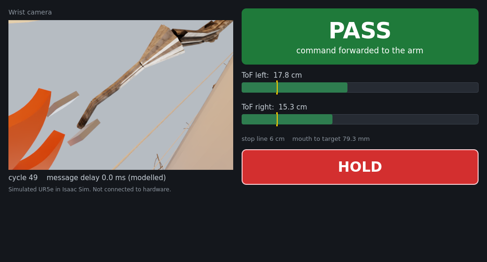
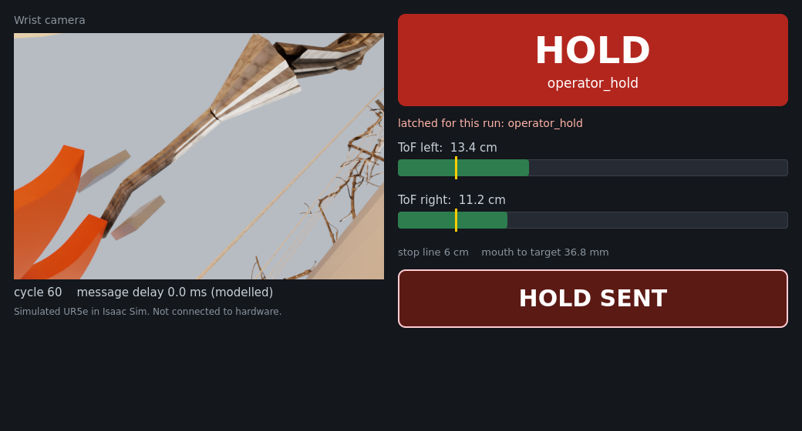

# Operator panel (Qt/QML) — November 5, 2026

`ros2/pruning_operator_panel` is a small desktop app for watching the live
pruning loop and stopping it. It shows what the C++ safety gate decided and
why, and its Hold button stops the simulated arm.

| Passing | After Hold |
|---|---|
|  |  |

Screenshots from the CPU rehearsal: the panel, the controller and the C++ gate
running live on a replayed 14944 capture, with the panel clicking its own Hold
button after 60 decisions. The camera image is the recorded wrist view.

## What it shows

- the wrist camera (`/pruning/wrist/image_raw`);
- a large green **PASS** or red **HOLD** banner with the gate's reason, and the
  reason that latched for the run (`/pruning/safety/decision`);
- one distance bar per time-of-flight sensor, its nearest usable return against
  the gate's 6 cm stop line (`/pruning/tof/{left,right}/range_image`);
- the control cycle, the mouth-to-target distance, and the modelled message delay
  of the run (`/pruning/sim/cycle`);
- a **HOLD** button. It publishes `pruning_sil_msgs/OperatorHold`; the safety
  gate latches it, so every later command is the measured pose. There is no
  remote release: a held run stays held, as every other gate stop does.

## How it is built

The standard Qt split: C++ for the logic, QML for the screen.

- **C++ backend** (`PanelBackend`): an `rclcpp` node spun on its own thread.
  Callbacks never touch the screen; each hands its data to the GUI thread with a
  queued call, where the properties QML binds to change. Camera frames reach QML
  through a `QQuickImageProvider`.
- **QML screen** (`qml/main.qml`, `qml/RangeBar.qml`): Qt Quick 2.15 with
  Controls 2. The Hold button's `onClicked` calls `backend.requestHold()`.
- Qt keywords are compiled out (`QT_NO_KEYWORDS`), so `signals`/`slots`/`emit`
  cannot collide with ROS headers.

It drives nothing but the simulated arm, and only through the safety gate.

## Measured, not asserted

The panel writes a JSONL record (`--record`) of every decision and camera frame it
receives and applies, every repaint (`QQuickWindow::frameSwapped`) with the
decision it was showing, and every Hold press. Two claims are scored from that
record and the gate's own decision log
([protocol](EVAL_PROTOCOL_ROS2_LIVE_LOOP_2026-11-05.md), R4–R5):

- **It keeps up.** Every gate decision is received, every pass/hold change is
  repainted before the next decision arrives, and every wrist frame arrives.
- **Hold works.** From the press to the simulator applying the first held
  command, measured in wall-clock milliseconds on one node and in control cycles.

For a headless run, `--auto-hold-after-cycles N` synthesizes a mouse click on
the QML Hold button after N decisions. That runs the real button and its
handler rather than a shortcut, as the panel's gtest does offscreen.

## Running it

```bash
# In the SIL image with Qt (ros2/containers/pruning_sil_humble_qt.def), workspace sourced:
ros2 run pruning_operator_panel operator_panel --record /tmp/panel.jsonl
# Headless, as in the batch jobs:
QT_QPA_PLATFORM=offscreen QT_QUICK_BACKEND=software \
  ros2 run pruning_operator_panel operator_panel --screenshot-dir /tmp/panel --auto-hold-after-cycles 60
```

On a desktop it opens a normal window. On this cluster, an Open OnDemand desktop
session can show it live; the batch jobs run it offscreen and keep screenshots.

## Where not to use it

The replay studio and the headset views are web pages and stay web pages. A
native panel fits a small onboard computer without a browser stack, such as a
robot's own status screen. That is a possible later use, not something done here.

## Results

See the live-loop protocol's result section once the registered batch has run.
The CPU rehearsal on the replayed 14944 capture is in
[ROS2_SIL.md](ROS2_SIL.md#live-loop-rehearsal-on-cpu).
