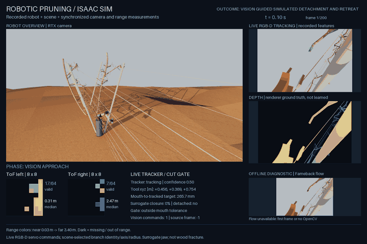

# Pruning: results and evaluation record

[Project overview](../README.md) · Full evidence behind the README summary.

These are recorded results, with their original populations and limitations. Follow each protocol and artifact before comparing experiments.

## Results and limits

- **Selected baseline sequence:** 68 vision commands, release at 7.8 s, 809.49 mm fall, and <0.001 mm final home error; 17/17 independent checks. [Evidence](evidence/two_tree_summary_2026-09-14.json).
- **Registered population study:** 0/40 planned trials completed; 20 trials had invalid tree1 registrations. The remaining tree0 trials stopped or were refused by vision, contact, ToF, or layout checks. A later valid seven-target tree1 study passed 2/7; a separate seeded 30-target draw passed 1/30. These populations are not pooled. [Original sweep](EVAL_PROTOCOL_2026-09-23.md) · [Listed targets](EVAL_PROTOCOL_STRATEGIES_2026-09-23.md) · [Seeded population](EVAL_PROTOCOL_PERCEPTION_2026-09-26.md).
- **October 2, depth-aware appearance:** target 15004 completed 4/4 targeted morning/evening trials with 17/17 checks. Genuine jaw and wire occlusions remained rejected; live and offline decisions agreed across all 10 runs. Depth is simulator ground truth. [Protocol](EVAL_PROTOCOL_DEPTH_APPEARANCE_CLOSED_LOOP_2026-10-01.md) · [Receipt](evidence/depth_loop_verdicts_2026-10-02.json).
- **October 2, jaw-aware closure:** a known-map plan, jaw self-mask, and closure hold completed contact target 530 in 3/3 repeats. This variant waives freshness and frame-reuse checks on held frames and uses exact simulated jaw poses; it is reported separately from unchanged-gate results. [Protocol](EVAL_PROTOCOL_JAW_IN_VIEW_2026-10-01.md) · [Receipt](evidence/jaw_in_view_verdicts_2026-10-02.json).
- **October 4, agreement arm:** evening target 14944, which still stopped under the depth-aware check, completed 4/4 trials with 17/17 checks. Once the depth test accepted the shadow event, the depth-agreement fraction replaced the collapsed appearance score in the confidence gate. Jaw and wire occlusions still stopped, and live and offline decisions agreed across all 6 runs. This variant changes the confidence gate's input on accepted frames and is reported separately. Depth is simulator ground truth. [Protocol](EVAL_PROTOCOL_AGREEMENT_ARM_CLOSED_LOOP_2026-10-03.md) · [Receipt](evidence/agreement_loop_verdicts_2026-10-04.json) · [Pass (GIF)](demo/isaac_tree1_v14944_evening_agreement_pass.gif) · [Earlier stop, same target and light (GIF)](demo/isaac_tree1_v14944_evening_vision_invalid.gif).
- **October 5, closure hold on unseen targets (negative result):** three new contact targets chosen by the rebuilt known-map planner reached closure in 0 of 9 trials, so the hold was never exercised. One spur was occluded at home, the open jaw covered another's patch on the approach, and tracking was lost during the third's re-orientation. These were the planner's perception predictions; its geometry passed its acceptance test. The 530 and 14944 controls passed as before. [Protocol](EVAL_PROTOCOL_HOLD_GENERALIZATION_2026-10-04.md) · [Receipt](evidence/hold_gen_verdicts_2026-10-05.json).
- **October 6, closure-hold sweep (scored November 22):** the same labelled arm once on each of 28 planner-qualified targets. 4 of 28 passed 17/17. Six reached closure; in all six the hold carried the cut to detachment, and 2 of those 6 failed only because the released piece did not fall 20 mm. Nineteen of the 25 initialized targets stopped on the tracker before closure (7 depth rejections, 5 jaw-mask occlusions, 5 first-update losses, 2 appearance losses), and the home visibility check predicted the other 3 exactly. The 530 control failed on tracker drift during closure; 14944 passed. S1, S3–S6 supported, S2 untested, S7 refuted. [Result](EVAL_PROTOCOL_HOLD_SWEEP_2026-10-06.md#result--november-22-2026).
- **November 25, longer episode under command delay:** the 66.7 and 100 ms delays that failed the return-home check on November 5 were rerun with a 30 s episode, with the prediction and scorer registered first. All six runs passed 17/17, with the cut at frames 120 and 142 and the arm home at frames 233 and 277, as registered. The earlier failures were the 20 s episode ending during the retreat. Command delay only, one target, simulation. [Result](EVAL_PROTOCOL_DELAY_EPISODE_2026-11-25.md#result--november-25-2026).
- **November 25, jaw-presence input for the gate (replay):** the gate takes the target from the controller it gates, so it gained an optional input the controller does not produce: blocked beams of a nine-beam grid across the jaw gap, computed offline at recorded poses. Five predictions were registered first. Off, the node matched the November 5 verdicts on 43,623 of 43,623 cycles. On, none of 205 usable captures changed, and with every beam reported clear the node stopped 87 of 87 closures before the jaw moved. The fourth prediction was refuted: with the jaw 20 mm short of the spur the gate refused 82 of 87 closures and accepted 5, all on target 8235, where other wood crossed a beam. No simulated sensor publishes the reading and no live run has used it. [Protocol and result](EVAL_PROTOCOL_JAW_PRESENCE_2026-11-25.md#result--november-25-2026).
- **November 25, ground audit:** the same cast found the tool beneath the orchard's visual ground in 28 of 233 recorded captures, on targets 530, 590, 3721, 3433, 3493 and 3673. The ground relief collides with nothing and is in neither the ToF sensors' nor the planner's mesh set, so no check noticed. Every run on control 530 is affected, including the October 2 jaw-aware closure (3/3) and the October 6 sweep's control. The registered verdicts stand as recorded; what they show about a physical approach is limited by this, and dated notes on each are pending. [Audit](EVAL_PROTOCOL_JAW_PRESENCE_2026-11-25.md#result--november-25-2026).
- **ROS 2 software-in-the-loop:** 199/199 recorded decision states reproduced; maximum command delta 1.995 mm. A C++17 ToF-deprojection port is checked against Python on 232 recorded zones at 1e-9 m tolerance. Recorded simulation replay, not hardware-in-the-loop. [Method and evidence](ROS2_SIL.md).

These are targeted diagnostics and narrow populations. They establish inspectable simulator behavior, not orchard-wide reliability, continuous contact safety, or deployed hardware performance.

## Latest visual comparison

*Same target and lighting as the [earlier appearance-stop recording](demo/isaac_tree1_v15004_evening_appearance_stop.gif). The depth check accepts the shadow event; real occlusion controls still stop. This is one of four targeted passes.*

