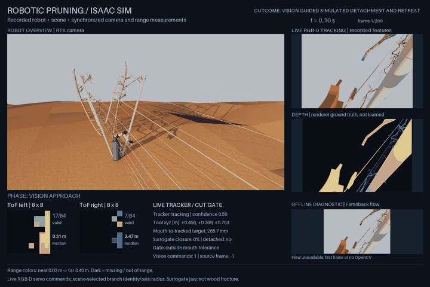

# Pruning: results and evaluation record

[Project overview](../README.md) · Full evidence behind the README summary.

These are recorded results, with their original populations and limitations. Follow each protocol and artifact before comparing experiments.

## Results and limits

- **Selected baseline sequence:** 68 vision commands, release at 7.8 s, 809.49 mm fall, and <0.001 mm final home error; 17/17 independent checks. [Evidence](evidence/two_tree_summary_2026-09-14.json).
- **Registered population study:** 0/40 planned trials completed; 20 trials had invalid tree1 registrations. The remaining tree0 trials stopped or were refused by vision, contact, ToF, or layout checks. A later valid seven-target tree1 study passed 2/7; a separate seeded 30-target draw passed 1/30. These populations are not pooled. [Original sweep](EVAL_PROTOCOL_2026-09-23.md) · [Listed targets](EVAL_PROTOCOL_STRATEGIES_2026-09-23.md) · [Seeded population](EVAL_PROTOCOL_PERCEPTION_2026-09-26.md).
- **October 2, depth-aware appearance:** target 15004 completed 4/4 targeted morning/evening trials with 17/17 checks. Genuine jaw and wire occlusions remained rejected; live and offline decisions agreed across all 10 runs. Depth is simulator ground truth. [Protocol](EVAL_PROTOCOL_DEPTH_APPEARANCE_CLOSED_LOOP_2026-10-01.md) · [Receipt](evidence/depth_loop_verdicts_2026-10-02.json).
- **October 2, jaw-aware closure:** a known-map plan, jaw self-mask, and closure hold completed contact target 530 in 3/3 repeats. This variant waives freshness and frame-reuse checks on held frames and uses exact simulated jaw poses; it is reported separately from unchanged-gate results. [Protocol](EVAL_PROTOCOL_JAW_IN_VIEW_2026-10-01.md) · [Receipt](evidence/jaw_in_view_verdicts_2026-10-02.json).
- **October 4, agreement arm:** evening target 14944, which still stopped under the depth-aware check, completed 4/4 trials with 17/17 checks. Once the depth test accepted the shadow event, the depth-agreement fraction replaced the collapsed appearance score in the confidence gate. Jaw and wire occlusions still stopped, and live and offline decisions agreed across all 6 runs. This variant changes the confidence gate's input on accepted frames and is reported separately. Depth is simulator ground truth. [Protocol](EVAL_PROTOCOL_AGREEMENT_ARM_CLOSED_LOOP_2026-10-03.md) · [Receipt](evidence/agreement_loop_verdicts_2026-10-04.json) · [Pass (GIF)](demo/isaac_tree1_v14944_evening_agreement_pass.gif) · [Earlier stop, same target and light (GIF)](demo/isaac_tree1_v14944_evening_vision_invalid.gif).
- **October 5, closure hold on unseen targets (negative result):** three new contact targets chosen by the rebuilt known-map planner reached closure in 0 of 9 trials, so the hold was never exercised. One spur was occluded at home, the open jaw covered another's patch on the approach, and tracking was lost during the third's re-orientation. These were the planner's perception predictions; its geometry passed its acceptance test. The 530 and 14944 controls passed as before. [Protocol](EVAL_PROTOCOL_HOLD_GENERALIZATION_2026-10-04.md) · [Receipt](evidence/hold_gen_verdicts_2026-10-05.json).
- **ROS 2 software-in-the-loop:** 199/199 recorded decision states reproduced; maximum command delta 1.995 mm. A C++17 ToF-deprojection port is checked against Python on 232 recorded zones at 1e-9 m tolerance. Recorded simulation replay, not hardware-in-the-loop. [Method and evidence](ROS2_SIL.md).

These are targeted diagnostics and narrow populations. They establish inspectable simulator behavior, not orchard-wide reliability, continuous contact safety, or deployed hardware performance.

## Latest visual comparison

*Same target and lighting as the [earlier appearance-stop recording](demo/isaac_tree1_v15004_evening_appearance_stop.gif). The depth check accepts the shadow event; real occlusion controls still stop. This is one of four targeted passes.*

