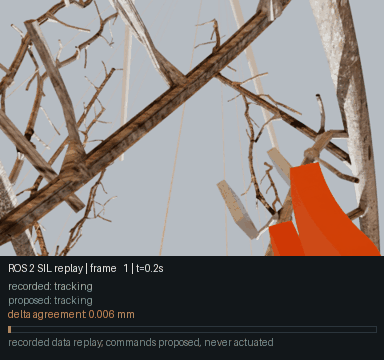

# ROS 2 software-in-the-loop — September 23, 2026

Updated October 6, 2026. The ROS 2 Humble node consumes timestamp-matched
RGB, optical-Z depth, camera intrinsics and tool poses from subscribed messages.
A tool-pose message triggers the decision for its recorded frame using the
preceding frame's camera bundle. It imports the existing `VisionPruningDemo`
visual controller; no perception or control law is reimplemented.

Target identity, camera world transforms and contact context remain recorded
capture metadata. ToF topics are telemetry in this ROS node; since November 5
the ToF and cut checks run in the C++ safety gate below.

**November 5, 2026.** The two stop-or-go checks now run in C++17 inside ROS 2:
[`safety_gate_node`](#november-5-c-safety-gate) sits between the controller and
the arm and forwards a command only when the time-of-flight clearance check and
the cut check both pass. It made the same call as the Python checks on all
**43,623** recorded control cycles of 217 captures and held the arm on all
**23** injected stopping faults. The same node then gated a live loop in which
ROS 2 drives the simulated UR5e
([protocol](EVAL_PROTOCOL_ROS2_LIVE_LOOP_2026-11-05.md)).

**This is software-in-the-loop. It is not hardware-in-the-loop.** No physical
VL53L8CX, camera or UR5e has been driven by anything here. In the replay below,
proposed commands are published and never actuated; in the live loop they move
only the simulated arm in Isaac Sim.

## Result

The September 23 controller-file replay of capture `21328323` reproduced the
recorded run. That harness calls the controller directly; it did not establish
subscribed-input graph behavior:

| Measure | Result |
|---|---|
| Frames compared | 199 of 200 |
| Decision-state agreement | **199 / 199** |
| Command delta error | median 0.07 mm, p95 0.68 mm, **max 1.995 mm** |
| Stated command tolerance | 2 mm |
| RGB-blackout control | 39 / 39 frames held, 0 approaches or releases |
| Depth-dropout control | 39 / 39 frames held, 0 approaches or releases |

Evidence: [`docs/evidence/ros2_sil_parity_2026-09-23.json`](evidence/ros2_sil_parity_2026-09-23.json),
which records every frame, not just the summary.



The animation above is the replay running: each frame shows the recorded
decision state, the state this node proposed, and how closely the command delta
agreed, against the 2 mm tolerance bar.

The one frame not compared is frame 0, where the capture records
`controller_source_frame_index = -1`: no image had been observed yet. The node
publishes an explicit `hold` with reason `no_camera_observation` and **no pose**,
rather than inventing a command.

### October 6: subscribed-input graph validation

The original node stored received images but its explicit `step_frame` read
images from files; the launch had no callback that advanced the controller.
The repair makes tool-pose callbacks drive the graph from incoming messages.
It matches RGB, depth and intrinsics by capture timestamp, tolerates reordered
delivery, rejects malformed images and latches a no-pose hold when a required
source bundle remains incomplete for 250 ms. It never substitutes the latest
available image or falls back to image files. A new replay is needed after a
stream fault. Image decoding also respects padded rows and big-endian depth.

Validation used actual ROS 2 publishers and subscribers on the same 200-frame
capture, with the servo's image-file readers replaced by functions that fail:

| Measure | Result |
|---|---|
| Received graph decisions | 200, including frame 0's no-image hold |
| Decision-state agreement | **199 / 199** |
| Maximum command delta error | **1.995 mm**, within the unchanged 2 mm reporting tolerance |
| Published pose timestamps | 199 / 199 match capture time |
| Servo image-file reads / manual `step_frame` calls | **0 / 0** |
| Injected fault decisions held | **80 / 80**, zero authorized motion states or nonzero command deltas |
| ROS 2 package tests | **33 passed** in the existing Humble container |

Eight fault scenarios contributed 10 affected decisions each: RGB blackout,
depth dropout, negative depth, missing depth, wrong depth timestamp, wrong
optical frame, malformed depth payload and invalid intrinsics. Blackout and
invalid-depth tracker decisions publish a stationary hold pose; missing or
malformed source bundles publish the hold decision with no new pose.

Evidence: [per-frame graph and fault results](evidence/ros2_graph_parity_2026-10-06.json).
This validates the message path on one simulated capture, not robot deployment
or general target success. The September 23 file-replay result remains separate.

### November 5: C++ safety gate

`ros2/pruning_sil_cpp` now holds the two checks the Isaac recorder runs before
it lets the arm move, ported to C++17 and wrapped in a node every arm command
passes through:

- **ToF clearance** (`sensor_guard`): hold if any usable zone of either sensor
  reads under 6 cm, or if neither sensor has a usable zone for 4 cycles.
- **Cut check** (`evaluate_cut_gate`): hold unless the target is the selected
  branch, the vision is valid and at most 0.25 s old, there is no hazard contact
  (over 5 N), the branch radius is within the demo limit, and the geometry is
  finite. Mouth position (8 mm) and jaw alignment (15°) decide whether the jaw
  may close.

The node pairs each cycle's ToF range images, tool pose, contact wrench, target
estimate and controller proposal by stamp. If both checks pass it forwards the
proposal; otherwise it commands the measured pose and publishes why
(`pruning_sil_msgs/SafetyDecision`). A hold latches for the run, as in the
recorder. Precedence follows the recorder too: operator, then ToF, then the cut
check. Rules that exist only in the node also hold the arm: a missing input
after the timeout, a malformed or wrong-frame message, an operator hold, or the
jaw advancing on a cycle that is not ready to close. The nearest ToF return is
located with the existing C++ deprojection.

**Inputs from the recordings.** `tools/export_gate_parity.py` rebuilds every
cycle's gate inputs from `frames.json`: the fresh ToF grids, the tool pose, the
contact force and the tracker measurement. It runs the Python checks on them
(`isaaclab_pruning.task.safety_gate`) and checks them against what the runs
logged at the time. 217 of 302 captures are live vision runs with telemetry
(81 recorded no frames, 4 had no selected target).

| Rebuilt inputs vs the recordings | Result |
|---|---|
| Cut certificates (flags, reasons, distance, alignment, age) | **43,623 / 43,623** identical |
| First stop of each run | **217 / 217** agree (131 came from these two checks) |
| ToF missing-frame counter | 43,608 / 43,623; all 15 are after a frame-0 stop in Sept 9 job `21222710`, whose recorder stopped updating the counter once stopped |

**C++ against Python.** `tools/validate_safety_gate.py` starts the C++ node and
publishes every rebuilt cycle's six input messages over ROS 2, one cycle at a
time, then compares the node's decision with the Python verdict:

| Measure | Result |
|---|---|
| Cycles where the C++ node made the same call for the same reason | **43,623 / 43,623** (217 captures) |
| Held cycles, C++ / Python | 24,817 / 24,817 |
| Forwarding rule (pass → proposal, hold → measured pose, no jaw advance on a hold) | 0 violations |
| Stopping faults that held the arm from the expected cycle to the end | **23 / 23** |
| gtest parity on the committed 120-cycle fixture | passes (17 C++ tests) |

The 23 faults run on the replayed capture `21328323`, starting at cycle 60:

- **ToF:** both sensors dead or garbage (holds at the 4th cycle, as specified), a 3 cm obstacle.
- **Vision:** 300 ms stale, 50 ms in the future, vision lost.
- **Cut check:** wrong target, not a branch, a 20 mm branch, NaN target, 12 N contact.
- **Malformed or wrong-frame messages:** ToF, tool pose, contact and target.
- **Dropped messages:** a ToF image, the proposal or the target.
- **Other:** a jaw advance without readiness, and an operator hold.

After the first hold, no fault run commanded motion. One case is reported
because it does **not** stop: with only one dead sensor the arm carries on,
because the Python rule pools both sensors. That is a limitation of the rule as
recorded, kept unchanged.

Evidence: [C++ vs Python and faults](evidence/cpp_safety_gate_parity_2026-11-05.json)
· [rebuilt inputs vs recordings](evidence/safety_gate_input_rebuild_2026-11-05.json),
both produced at `025c1d4` (CPU job 22039665).

**Frame labels.** Recorded tool poses and controller commands are world-frame
values (the UR5e root is 0.7 m up on the bench). Until November 5 the replay
labelled them `base_link`. The replay now labels them `world`, publishes
`world → base_link` from the recorded root pose, and the RViz fixed frame is
`world`.

### Where the small disagreement comes from

The evidence reports two errors, because they mean different things. The
tracker's estimated branch position differs from the recording by a median of
**2.7 mm**, while the proposed command differs by a median of **0.07 mm** — the
measurement error is the larger of the two.

That ordering is the interesting part. The tracker is iterative: its feature set
evolves from frame 0, so any floating-point difference between this host and the
recording host accumulates in the position estimate. The command is a *bounded*
step toward that estimate, so the bound attenuates the accumulated perception
difference rather than passing it through. A command error larger than its
measurement error would have pointed at the control path; it does not.

Two hypotheses were tested and rejected. Rebuilding with OpenCV 4.11.0, the
version the capture was recorded with, produced **identical** numbers, so the
OpenCV version is not the cause. Decision states agree exactly in every frame,
so the divergence never changes a decision.

## Running it

Everything runs in an Apptainer image built from the official ROS 2 Humble
`ros-base`, defined in [`ros2/containers/pruning_sil_humble.def`](../ros2/containers/pruning_sil_humble.def):

```bash
export APPTAINER_CACHEDIR=/nfs/hpc/share/$USER/apptainer-cache
export APPTAINER_TMPDIR=/nfs/hpc/share/$USER/apptainer-tmp
apptainer pull ros-humble-ros-base.sif docker://ros:humble-ros-base
apptainer build --fakeroot pruning_sil_humble.sif ros2/containers/pruning_sil_humble.def
```

Home directories on this cluster are small, hence the cache and temp overrides.

Export a capture to a bag, then replay it as a graph:

```bash
# Capture -> rosbag2. MCAP is the default storage.
python3 -m pruning_sil.export_rosbag2 \
  --capture-dir artifacts/isaac_render/job_21328323 \
  --output /scratch/$USER/sil-bag

# Player publishes recorded sensors; the servo node proposes commands from them.
ros2 launch pruning_sil sil_replay.launch.py \
  capture_dir:=artifacts/isaac_render/job_21328323

# Reproduce the parity evidence above.
python3 -m pruning_sil.parity \
  --capture-dir artifacts/isaac_render/job_21328323 \
  --output docs/evidence/ros2_sil_parity_<date>.json

# Exercise actual subscribed messages and eight sensor-fault controls.
python3 tools/validate_ros_stream.py \
  --capture-dir artifacts/isaac_render/job_21328323 \
  --output docs/evidence/ros2_graph_parity_<date>.json

# C++ safety gate: rebuild every recorded cycle (Python, no ROS), then drive the
# node with them and with the faults (inside the container, workspace sourced).
python3 tools/export_gate_parity.py --roots artifacts \
  --cycles-out /scratch/$USER/cycles.jsonl.gz --summary-out /scratch/$USER/rebuild.json
python3 tools/validate_safety_gate.py --cycles /scratch/$USER/cycles.jsonl.gz \
  --gate install/pruning_sil_cpp/lib/pruning_sil_cpp/safety_gate_node \
  --output docs/evidence/cpp_safety_gate_parity_<date>.json
```

On this cluster `hpc/slurm/ros2_gate_check.sbatch` builds the packages in
node-local scratch, runs the pytest and gtest suites and then the harness.

An RViz2 layout is at [`ros2/pruning_sil/config/pruning_sil.rviz`](../ros2/pruning_sil/config/pruning_sil.rviz):
wrist RGB, wrist depth, TF, and the recorded and proposed command poses side by
side. The proposed pose is labelled advisory in the display name, because a
viewer should never mistake it for something the robot executed.

## Interface

### Topics, types and frames

| Topic | Type | Frame | QoS |
|---|---|---|---|
| `/pruning/wrist/image_raw` | `sensor_msgs/Image` (`rgb8`) | `mock_pruner__wrist_camera_optical_frame` | sensor data |
| `/pruning/wrist/depth` | `sensor_msgs/Image` (`32FC1`, metres, optical-Z) | same | sensor data |
| `/pruning/wrist/camera_info` | `sensor_msgs/CameraInfo` | same | sensor data |
| `/pruning/tof/{left,right}/distance` | `std_msgs/Float32MultiArray` (8×8, metres) | `mock_pruner__tof{0,1}` | sensor data |
| `/pruning/tof/{left,right}/valid` | `std_msgs/UInt8MultiArray` (8×8) | same | sensor data |
| `/joint_states` | `sensor_msgs/JointState` | — | reliable |
| `/pruning/tool_pose` | `geometry_msgs/PoseStamped` | `world` → `mock_pruner__tool0` | reliable |
| `/tf`, `/tf_static` | `tf2_msgs/TFMessage` | — | reliable |
| `/pruning/recorded/command_pose` | `geometry_msgs/PoseStamped` | `base_link` | reliable |
| `/pruning/recorded/release` | `std_msgs/String` (JSON) | — | reliable |
| `/pruning/proposed/command_pose` | `geometry_msgs/PoseStamped` | `world` | reliable |
| `/pruning/proposed/decision` | `std_msgs/String` (JSON) | — | reliable |
| `/pruning/tof/{left,right}/range_image` | `sensor_msgs/Image` (`32FC1` 8×8, metres, NaN = no usable zone) | `mock_pruner__tof{0,1}` | reliable |
| `/pruning/contact/wrench` | `geometry_msgs/WrenchStamped` (largest arm contact force) | `world` | reliable |
| `/pruning/perception/target` | `pruning_sil_msgs/TargetEstimate` | `world` | reliable |
| `/pruning/proposed/proposal` | `pruning_sil_msgs/ControllerProposal` | `world` | reliable |
| `/pruning/safety/decision` | `pruning_sil_msgs/SafetyDecision` (+ `decision_json` mirror) | — | reliable |
| `/pruning/gated/command_pose` | `geometry_msgs/PoseStamped`, the only command the simulated arm obeys | `world` | reliable |
| `/pruning/gated/jaw` | `sensor_msgs/JointState` (`mock_pruner__jaw_closure`, 0–1) | — | reliable |
| `/pruning/operator/hold` | `pruning_sil_msgs/OperatorHold` | — | reliable, transient local |

Images and time-of-flight grids use sensor-data QoS (best effort, depth 5), so a
slow subscriber drops samples rather than stalling the pipeline. Commands and
decisions are reliable: losing a `hold` decision is not an acceptable failure
mode, even in replay.

Depth is `32FC1` in metres along the optical Z axis, not ray length, and not
millimetres. Non-hits stay non-finite rather than becoming a plausible range.

Images, camera info, poses, joint states and TF retain capture timestamps.
The ToF `MultiArray` messages have no header and are telemetry only in this
node; this graph does not certify ToF freshness or synchronization.

### Mapping to the real rig

The pinned packages are in `third_party/sources.yaml` and fetched under
`third_party/src/branch_detection_system`. Their repository root is
`NOASSERTION` and their integration is `fetch_only`, so this package **maps** to
their interface rather than vendoring it, and builds without them.

| This package | Real rig | Note |
|---|---|---|
| `/pruning/tof/{left,right}/distance`, `Float32MultiArray`, metres | `/microROS/vl53l8cx/distance`, `vl53l8cx_msgs/Vl53l8cx8x8`, int32 **millimetres** | The real packet is unstamped and carries both sensors; the filtered stream `/vl53l8cx/distance_filtered` is `Vl53l8cx8x8Filtered` with a header and float64. Upstream also exposes `tof0_filtered` / `tof1_filtered`. |
| `/joint_states`, `sensor_msgs/JointState` | `/joint_states`, `sensor_msgs/JointState` | Same topic and type. |
| `/pruning/proposed/command_pose`, `PoseStamped` | `/servo_node/delta_twist_cmds`, `geometry_msgs/TwistStamped` | The rig is driven through MoveIt Servo, which takes a **velocity**. This node proposes a bounded position delta per frame; a bring-up divides by the control period. At the recorded 10 Hz that divisor is 0.1 s. **This conversion is not exercised here.** |
| `/pruning/wrist/image_raw` | rig-specific camera driver | The simulated wrist camera is a simulation-defined mount with no hardware calibration, so no real topic is claimed. |

One deliberate divergence: `vl53l8cx_msgs/Row8x8` declares `stride 8` and
`Column8x8` declares `stride 1`, because their stride is the step between
elements. `std_msgs/MultiArrayDimension` defines stride as the number of elements
the dimension spans, which is 64 and 8. Labels and sizes are copied exactly;
both strides differ. Copying their values would produce a `MultiArray` that every
standard consumer reads wrongly, so a bridge must translate. Both conventions are
recorded in `pruning_sil/topics.py` as `TOF_STRIDES_REAL` and `TOF_STRIDES_ROS`.

The VL53L8CX firmware evidence records continuous 8×8 operation at **15 Hz** in
raw millimetres. The replayed captures run at their own **10 Hz** capture rate.
Those are different numbers and neither is a latency claim.

## What would change for hardware

- **Sensor rate.** 15 Hz sensor against a 10 Hz replay. Freshness gates are
  written against capture time and would need real timestamps and a real clock.
- **Command type.** Position delta to `TwistStamped`, divided by the true control
  period, through MoveIt Servo with its own limits and collision checking.
- **Depth.** RTX optical-Z ground truth becomes a real depth sensor with noise,
  dropout, multipath and its own validity semantics.
- **Camera calibration.** The wrist mount is simulation-defined. Identifying the
  physical camera model and its calibrated optical transform is an open roadmap
  gate, not something this package supplies.
- **Target identity.** Branch identity, axis and radius come from scene metadata
  through `capture_dir`. On a rig that input must come from a perception stage,
  and this repository has no learned branch recognition.
- **Safety.** Nothing here is actuated. Anything driving hardware needs an
  authority model, an e-stop path and contact limits that this replay does not
  implement.

## What is not claimed

- Not hardware-in-the-loop, and never described as such.
- No physical sensor or robot has been driven.
- Proposed commands are advisory and are never actuated.
- Replay timings are replay timings, not latency or real-time guarantees.
- Parity is against **one** capture, `21328323`. It says nothing about captures
  the node has not replayed.
- Agreement of a replay with its own recording is reproducibility, not evidence
  that either is correct.

## C++ component

`ros2/pruning_sil_cpp` holds two C++17 parts, built with `ament_cmake` and
tested with gtest: the safety gate above (`safety_gates`, `safety_gate_node`)
and the time-of-flight deprojection
(`isaaclab_pruning.baselines.tof_servo.deproject_tof`), which the gate uses to
locate the nearest return. Neither drives hardware.

The parity test is the point. `test/tof_parity_fixture.json` holds reference
points produced by the **Python** implementation on real recorded 8×8 grids from
`21328323` — five frames × two sensors, 232 valid zones — and the C++ test
compares against those to 1e-9 m. The port is checked against what it claims to
reproduce, not against itself.

Invalid zones produce NaN, and a test asserts they never become the sensor
offset. A gate has to be able to tell "no measurement" from "a measurement at
the origin"; silently substituting a number erases that difference.

## Continuous integration

[`.github/workflows/ros2.yml`](../.github/workflows/ros2.yml) runs `colcon build`
and `colcon test` on both packages in a `ros:humble-ros-base` container.
`ros-base` rather than `ros:humble`, because rosbag2 is not in the core image.

Tests run against the procedural fixture in `ros2/pruning_sil/test/fixture.py`,
which builds its own textured scene. No orchard mesh, bark texture, mock-pruner
CAD or recorded capture exists on a clean runner, and the capture-dependent
parity test skips itself. A final step fails the build if any 3D asset appears in
the workspace, so a licensed asset cannot reach CI unnoticed.
