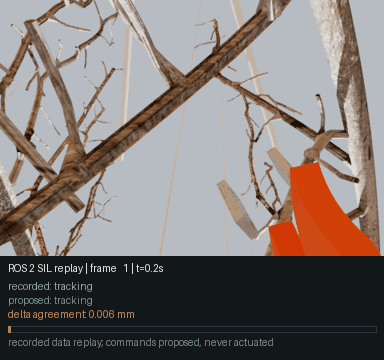

# ROS 2 software-in-the-loop — September 23, 2026

Updated October 6, 2026. The ROS 2 Humble node consumes timestamp-matched
RGB, optical-Z depth, camera intrinsics and tool poses from subscribed messages.
A tool-pose message triggers the decision for its recorded frame using the
preceding frame's camera bundle. It imports the existing `VisionPruningDemo`
visual controller; no perception or control law is reimplemented.

Target identity, camera world transforms and contact context remain recorded
capture metadata. ToF topics are telemetry in this ROS node; since November 5
the ToF and cut checks run in the C++ safety gate below.

**November 5, 2026.** The two stop-or-go checks now run in C++17 inside ROS 2:
[`safety_gate_node`](#november-5-c-safety-gate) sits between the controller and
the arm and forwards a command only when the time-of-flight clearance check and
the cut check both pass. It made the same call as the Python checks on all
**43,623** recorded control cycles of 217 captures and held the arm on all
**23** injected stopping faults. The same node then gated a live loop in which
ROS 2 drives the simulated UR5e
([protocol](EVAL_PROTOCOL_ROS2_LIVE_LOOP_2026-11-05.md)).

**This is software-in-the-loop. It is not hardware-in-the-loop.** No physical
VL53L8CX, camera or UR5e has been driven by anything here. In the replay below,
proposed commands are published and never actuated; in the live loop they move
only the simulated arm in Isaac Sim.

## Result

The September 23 controller-file replay of capture `21328323` reproduced the
recorded run. That harness calls the controller directly; it did not establish
subscribed-input graph behavior:

| Measure | Result |
|---|---|
| Frames compared | 199 of 200 |
| Decision-state agreement | **199 / 199** |
| Command delta error | median 0.07 mm, p95 0.68 mm, **max 1.995 mm** |
| Stated command tolerance | 2 mm |
| RGB-blackout control | 39 / 39 frames held, 0 approaches or releases |
| Depth-dropout control | 39 / 39 frames held, 0 approaches or releases |

Evidence: [`docs/evidence/ros2_sil_parity_2026-09-23.json`](evidence/ros2_sil_parity_2026-09-23.json),
which records every frame, not just the summary.



The animation above is the replay running: each frame shows the recorded
decision state, the state this node proposed, and how closely the command delta
agreed, against the 2 mm tolerance bar.

The one frame not compared is frame 0, where the capture records
`controller_source_frame_index = -1`: no image had been observed yet. The node
publishes an explicit `hold` with reason `no_camera_observation` and **no pose**,
rather than inventing a command.

### October 6: subscribed-input graph validation

The original node stored received images but its explicit `step_frame` read
images from files; the launch had no callback that advanced the controller.
The repair makes tool-pose callbacks drive the graph from incoming messages.
It matches RGB, depth and intrinsics by capture timestamp, tolerates reordered
delivery, rejects malformed images and latches a no-pose hold when a required
source bundle remains incomplete for 250 ms. It never substitutes the latest
available image or falls back to image files. A new replay is needed after a
stream fault. Image decoding also respects padded rows and big-endian depth.

Validation used actual ROS 2 publishers and subscribers on the same 200-frame
capture, with the servo's image-file readers replaced by functions that fail:

| Measure | Result |
|---|---|
| Received graph decisions | 200, including frame 0's no-image hold |
| Decision-state agreement | **199 / 199** |
| Maximum command delta error | **1.995 mm**, within the unchanged 2 mm reporting tolerance |
| Published pose timestamps | 199 / 199 match capture time |
| Servo image-file reads / manual `step_frame` calls | **0 / 0** |
| Injected fault decisions held | **80 / 80**, zero authorized motion states or nonzero command deltas |
| ROS 2 package tests | **33 passed** in the existing Humble container |

Eight fault scenarios contributed 10 affected decisions each: RGB blackout,
depth dropout, negative depth, missing depth, wrong depth timestamp, wrong
optical frame, malformed depth payload and invalid intrinsics. Blackout and
invalid-depth tracker decisions publish a stationary hold pose; missing or
malformed source bundles publish the hold decision with no new pose.

Evidence: [per-frame graph and fault results](evidence/ros2_graph_parity_2026-10-06.json).
This validates the message path on one simulated capture, not robot deployment
or general target success. The September 23 file-replay result remains separate.

### November 5: C++ safety gate

`ros2/pruning_sil_cpp` now holds the two checks the Isaac recorder runs before
it lets the arm move, ported to C++17 and wrapped in a node every arm command
passes through:

- **ToF clearance** (`sensor_guard`): hold if any usable zone of either sensor
  reads under 6 cm, or if neither sensor has a usable zone for 4 cycles.
- **Cut check** (`evaluate_cut_gate`): hold unless the target is the selected
  branch, the vision is valid and at most 0.25 s old, there is no hazard contact
  (over 5 N), the branch radius is within the demo limit, and the geometry is
  finite. Mouth position (8 mm) and jaw alignment (15°) decide whether the jaw
  may close.

The node pairs each cycle's ToF range images, tool pose, contact wrench, target
estimate and controller proposal by stamp. If both checks pass it forwards the
proposal; otherwise it commands the measured pose and publishes why
(`pruning_sil_msgs/SafetyDecision`). A hold latches for the run, as in the
recorder. Precedence follows the recorder too: operator, then ToF, then the cut
check. Rules that exist only in the node also hold the arm: a missing input
after the timeout, a malformed or wrong-frame message, an operator hold, or the
jaw advancing on a cycle that is not ready to close. The nearest ToF return is
located with the existing C++ deprojection.

**Inputs from the recordings.** `tools/export_gate_parity.py` rebuilds every
cycle's gate inputs from `frames.json`: the fresh ToF grids, the tool pose, the
contact force and the tracker measurement. It runs the Python checks on them
(`isaaclab_pruning.task.safety_gate`) and checks them against what the runs
logged at the time. 217 of 302 captures are live vision runs with telemetry
(81 recorded no frames, 4 had no selected target).

| Rebuilt inputs vs the recordings | Result |
|---|---|
| Cut certificates (flags, reasons, distance, alignment, age) | **43,623 / 43,623** identical |
| First stop of each run | **217 / 217** agree (131 came from these two checks) |
| ToF missing-frame counter | 43,608 / 43,623; all 15 are after a frame-0 stop in Sept 9 job `21222710`, whose recorder stopped updating the counter once stopped |

**C++ against Python.** `tools/validate_safety_gate.py` starts the C++ node and
publishes every rebuilt cycle's six input messages over ROS 2, one cycle at a
time, then compares the node's decision with the Python verdict:

| Measure | Result |
|---|---|
| Cycles where the C++ node made the same call for the same reason | **43,623 / 43,623** (217 captures) |
| Held cycles, C++ / Python | 24,817 / 24,817 |
| Forwarding rule (pass → proposal, hold → measured pose, no jaw advance on a hold) | 0 violations |
| Stopping faults that held the arm from the expected cycle to the end | **23 / 23** |
| gtest parity on the committed 120-cycle fixture | passes (17 C++ tests) |

The 23 faults run on the replayed capture `21328323`, starting at cycle 60:

- **ToF:** both sensors dead or garbage (holds at the 4th cycle, as specified), a 3 cm obstacle.
- **Vision:** 300 ms stale, 50 ms in the future, vision lost.
- **Cut check:** wrong target, not a branch, a 20 mm branch, NaN target, 12 N contact.
- **Malformed or wrong-frame messages:** ToF, tool pose, contact and target.
- **Dropped messages:** a ToF image, the proposal or the target.
- **Other:** a jaw advance without readiness, and an operator hold.

After the first hold, no fault run commanded motion. One case is reported
because it does **not** stop: with only one dead sensor the arm carries on,
because the Python rule pools both sensors. That is a limitation of the rule as
recorded, kept unchanged.

Evidence: [C++ vs Python and faults](evidence/cpp_safety_gate_parity_2026-11-05.json)
· [rebuilt inputs vs recordings](evidence/safety_gate_input_rebuild_2026-11-05.json),
both produced at `025c1d4` (CPU job 22039665).

**Frame labels.** Recorded tool poses and controller commands are world-frame
values (the UR5e root is 0.7 m up on the bench). Until November 5 the replay
labelled them `base_link`. The replay now labels them `world`, publishes
`world → base_link` from the recorded root pose, and the RViz fixed frame is
`world`.

### November 5: ROS 2 drives the simulated arm

With `PRUNING_ROS2_LOOP=1` the Isaac recorder keeps rendering, stepping and
grading as before, but the controller and the safety gate run as ROS 2 nodes
in this container. The simulated UR5e moves **only** on
`/pruning/gated/command_pose`:

```
Isaac Sim ──RGB, depth, ToF, contact, tool pose, joints──► live_controller ──proposal, target──► safety_gate_node (C++)
    ▲                                                                                                  │
    └──────────────────────────── /pruning/gated/command_pose, /pruning/gated/jaw ◄────────────────────┘
```

Isaac Sim joins the graph through its bundled ROS 2 Humble `rclpy` (standard
messages only). The loop is lockstep: the simulator waits for each gated
command, so transport time never becomes simulated time. Message delay is
modelled in simulated time instead, as described in the
[protocol](EVAL_PROTOCOL_ROS2_LIVE_LOOP_2026-11-05.md).

**Smoke run (exploratory).** On the known target (14944, source light,
baseline controller), the first ROS 2-driven run passed all 17 sequence checks.
The piece dropped 0.809 m and the arm returned within 0.25 µm of home. Every
frame carried a gate decision, and frames 1–199 applied exactly the gated
command (frame 0's answer was not recorded by that revision). The median
round trip from sensor publish to gated command was 1.9 ms. The registered
delay sweep and the panel Hold run are in the protocol.

#### Live-loop rehearsal on CPU

`tools/rehearse_ros2_loop.py` drives the same bridge class Isaac Sim uses, on
CPU, with a recorded capture's bundles in the recorder's causal order. This is
open loop (recorded poses do not respond), so it checks the message path, not
control. On the 14944 baseline repeat at `f0d57a2`:

- all 201 bundles were answered;
- the ROS 2 controller matched the recorded in-process decision state, motion
  phase and cut phase on **200/200** cycles;
- the gate held none.

With the operator panel running and clicking its own Hold button after 60
decisions (`da918c5`), the gate held the next cycle with reason `operator_hold`.
No passing decision followed the press. The panel showed 201/201 decisions and
received 201/201 wrist frames.
[Evidence](evidence/ros2_live_loop_rehearsal_2026-11-05.json) ·
[panel](OPERATOR_PANEL.md).

### Where the small disagreement comes from

The evidence reports two errors, because they mean different things. The
tracker's estimated branch position differs from the recording by a median of
**2.7 mm**, while the proposed command differs by a median of **0.07 mm** — the
measurement error is the larger of the two.

That ordering is the interesting part. The tracker is iterative: its feature set
evolves from frame 0, so any floating-point difference between this host and the
recording host accumulates in the position estimate. The command is a *bounded*
step toward that estimate, so the bound attenuates the accumulated perception
difference rather than passing it through. A command error larger than its
measurement error would have pointed at the control path; it does not.

Two hypotheses were tested and rejected. Rebuilding with OpenCV 4.11.0, the
version the capture was recorded with, produced **identical** numbers, so the
OpenCV version is not the cause. Decision states agree exactly in every frame,
so the divergence never changes a decision.

### November 22: what the November 5 numbers contain

Three limits found on re-reading the November 5 work. None changes a
registered verdict. [Evidence](evidence/gate_evidence_audit_2026-11-22.json),
written by `tools/audit_gate_evidence.py` at `2da51ce`.

**How many parity cycles carried a decision.** A hold latches for the run, so
once a run has held, every later cycle is a hold whose outcome was already
fixed. Of the 43,623 matching cycles:

| Cycles | Count |
|---|---|
| Passing, before any hold | 18,806 |
| The first hold of a run | 145 (87 vision invalid, 30 ToF clearance, 24 hazard contact, 4 lost during closure) |
| **Cycles where the gate had a decision to make** | **18,951** |
| After a latch | 24,672 |

72 of the 217 captures never held. The recordings contain only those four
first-hold reasons; every other rule is covered by the 23 injected faults alone.

**The freshness check never fired in the live loop.** The gate holds when
vision is more than 0.25 s old. In all 2,613 decisions of the 13 registered
live-loop runs the age was 0 s. The controller stamps each target estimate with
the capture time of its own frame (`vision_timestamp_s=float(time_s)` in
`VisionPruningDemo.observe`), and the modelled delay held back arm commands,
not images. The check is exercised by two injected faults (300 ms stale, 50 ms
in the future) and has not fired in closed loop.

**Which gate inputs are independent of the controller.**

| Input | Comes from | Independent of the controller |
|---|---|---|
| ToF ranges | the simulator's sensors | yes |
| Tool pose | the simulator's arm state | yes |
| Contact force | the simulator's contact sensing | yes |
| Target position, vision valid, vision time | the controller's tracker | no |
| Target id, label, axis, radius | configuration, passed through the controller | no: the id and label checks compare a configured value with itself |
| Cut phase and detached flag | the controller's own report | no |

So the gate catches a controller that crashes, goes silent, sends malformed or
wrong-frame messages, or reports a lost or stale track. It cannot catch a
tracker that confidently reports the wrong place, because the mouth-distance
check compares the measured pose with the controller's own estimate. The
October 6 sweep's 530 control shows the case: during closure the tracked target
drifted about 5.5 mm while the tracker still reported tracking and the
recorded piece pose did not move
([result](EVAL_PROTOCOL_HOLD_SWEEP_2026-10-06.md#result--november-22-2026)).
That drift pushed the mouth distance past 8 mm and the cut stopped; had it
stayed inside the tolerance, nothing in the gate could have told. The next step
is an input the controller does not produce.

**A correction made here on November 25 was wrong and is withdrawn.** It said
the ToF sensors cannot see the jaw mouth because they sit 144 mm along the
pruner's axis and the mouth is at 70 mm. Those two offsets are in different
frames. The sensor sites are 144 mm from `mock_pruner__base`
(`TOF_SITE_OFFSETS_M`); the mouth is 70 mm from the control-tool frame
(`DEMO_MOUTH_OFFSET_TOOL_M`), and that frame is itself 160 mm from the same base
(`ur5e_pruner.yaml`). In one frame the mouth is 86 mm **ahead** of the sensors
and 47 mm to the side of each: about 29° off each sensor's axis, at the inner
edge of its field of view (24° half-width, 32.5° on the diagonal). The recorded
sensor positions confirm it.

### November 25: what could witness the target in the mouth (exploratory)

`tools/study_mouth_evidence.py` re-casts candidate sensor readings on the CPU at
recorded tool poses, and at poses displaced from them, against the exported
orchard ([evidence](evidence/mouth_evidence_study_2026-11-25.json), at
`b144d6c`). Eleven runs that reached closure, nine distinct targets.
Exploratory: no threshold here is final, and nothing in the gate changed.

**Two of the eleven runs are not physical scenes.** Both are on target 530. That
spur lies in the orchard's ground relief, and in both runs the wrist camera, the
tool point and the jaw mouth are beneath the ground surface: the ground is
5.9 and 6.6 mm above the mouth and about 161 mm above the camera. The
simulation does not react to it: the relief is drawn and nothing collides with
it, and the simulated ToF sensors cast against the trees only. In the other
nine runs the ground is 350 mm or more below the mouth. The counts below
are for those nine runs (8 distinct targets, 333 poses); the two 530 runs are
described separately.

**The offline caster reproduces the simulated ToF sensors.** Its criterion was
fixed before the first run. Re-cast at the recorded sensor poses against the
trees, the two ToF grids agreed on validity in 110,207 of 110,208 zones, and
all 29,350 zones valid in both agreed within 1 mm (the largest difference was
0.03 mm).

**The depth image agrees in all eleven runs once the ground is in the mesh
set.** Around the pixel the mouth centre projects to, a 9 × 9 pixel patch of the
recorded depth image was compared with casts through the pixel centres. With
the trees alone, nine runs agreed on all 81 pixels and the two on target 530
agreed on 2 and 36. With the ground relief added, all eleven agree on all 81.
That is how the ground was found.

**Truth, from geometry only.** Nine segments cross the jaw gap. *Between the
jaws*: any of them intersects the target. *At the mouth centre*: the middle one
does. The second definition alone was the first pass; both are reported because
of what it showed, so neither is a registered definition.

At the frame the cut became ready, in the nine runs:

| | Result |
|---|---|
| Target between the jaws | 9 of 9 |
| Target on the segment through the mouth centre | **0 of 9** |
| Where the target centre was | 9.4 to 12.8 mm ahead of the mouth centre along the tool axis, toward the jaw tips |
| ToF: a first return inside the mouth box | 9 of 9, from 1 to 3 zones, all but one of them on the target |
| Beam grid: any beam blocked | 9 of 9 |
| Camera: the surface along the ray through the mouth centre is in the mouth box | 7 of 9 |

Then the whole tool was displaced from that pose along the jaw's three axes:

- **The cut closes near the jaw tips.** The tool advances about another 2 mm
  before the jaws start to move, which leaves the target centre 7.7 to
  11.1 mm ahead of the mouth centre; the closest spur has a 4.5 mm radius.
  Across all 54 recorded closing frames the target was between the jaws in every
  one and on the centre segment in none. From the ready pose, moving the tool
  10 mm forward puts the target on the centre segment in 9 of 9 (2 at 5 mm,
  8 at 15 mm, 0 at 20 mm, where it has passed the centre). Moving it 5 mm back
  leaves the target between the jaws in 6 of 9, and 10 mm back in 0.
- **The ToF sensors are a weak witness.** They see the target at closure only
  because it sits ahead of the mouth centre. With the tool 15 and 20 mm forward
  they report a return in the mouth box in 2 and 1 of 9 runs, although the
  target is between the jaws in 8 and 9. The likely cause is that the mouth
  centre lies in the strip between the two fields of view; that was not tested
  separately. With the tool 10 mm back they still report one in 7 of 9, where
  the target is between the jaws in 0.
- **A beam grid across the gap follows the geometry**, as it must: it is the same
  nine segments against every mesh. It reported the target in all 203 poses
  that had it between the jaws. In 11 of the 130 poses that did not, a beam was
  blocked by other wood. A single beam through the mouth centre would have
  refused every recorded cut.
- **One camera ray is fragile.** It agreed in 115 of the 203 poses with the
  target between the jaws. At the ready pose it says in for 7 of 9; shift the
  tool 5 mm along the closing axis and that becomes 9 of 9 one way and 1 of 9
  the other. It also shares the camera with the tracker.

**Target 530.** With the ground in the mesh set, every channel on 530 reads the
ground as well as the spur: two of the nine beams are blocked by ground at the
ready pose in both runs, the camera ray through the mouth centre ends on ground
in both, and the nearest usable ToF return would be the ground at the sensor's
30 mm minimum range, where the trees-only sensor recorded 70 to 71 mm. The gate's clearance limit is 60 mm, so
a ToF sensor that saw the ground would have stopped the arm before the cut.
In control 530's failed closure the target was between the jaws from frame 68 to
the stop at frame 76, and at least one ToF zone returned from it inside the
mouth box in every one of those frames, while the tracker's mouth distance rose
from 6.0 to 9.7 mm. The spur did not move relative to the jaws; the measurement
did. So that stop came from the tracker, and a second witness that can only
veto would not have changed the run. What an approach from beneath the ground
means for earlier results that used 530 as the control has not been assessed
(see [PENDING.md](PENDING.md)).

**The case a second witness is for** is a confident track with nothing between
the jaws. No recording contains one, so it has to be injected.

**Limits.** Nine usable runs and one family of approach poses. The displacements
are pure translations. The jaws are in no mesh set, so a real sensor may also
see its own jaws. The depth thresholds (0.5 mm, 95% of the patch) were chosen
after seeing the data. Depth is exact. Counts, not rates.

*How this section changed on November 25.* The first version (`64aa8c5`) pooled
all eleven runs, cast against the trees alone, and blamed a silhouette edge for
the depth mismatch on target 530; that reason was never tested and was wrong.
The second (`7c5673a`) reported the mismatch as an unidentified surface. This
version identifies it as the ground relief and separates the two 530 runs. The
caster validation and the truth tables for the nine runs did not change.

### November 25: a jaw-presence input for the gate (replay)

The gate gained one optional input the controller does not produce: how many
beams of a nine-beam grid across the jaw gap are blocked. It is off by default.
With `jaw_presence_min_beams` above 0, closure is authorized only while that
many beams are blocked, and a closure that continues with fewer stops. Nothing
in the simulation publishes the reading yet; `tools/cast_jaw_beams.py` computes
it offline at recorded tool poses. The predictions were registered before the
replay ([protocol and result](EVAL_PROTOCOL_JAW_PRESENCE_2026-11-25.md#result--november-25-2026)).

| | Result |
|---|---|
| Off: the node against the November 5 verdicts | 43,623 of 43,623 cycles; 23 of 23 faults as before |
| On, recorded-pose reading: recorded cuts changed | 0 of 205 captures (42,001 cycles) |
| On, every beam clear: closures stopped before the jaw moved | 87 of 87 |
| On, tool 20 mm short of the spur: closures refused | **82 of 87** (registered prediction: all; refuted) |
| A dropped or malformed reading holds | 3 of 3 |

The refuted row matters most. In 5 captures, all on target 8235, other wood
crossed a beam with the jaw 20 mm short of the spur, and the gate let the
recorded closure through. One blocked beam says something is in the gap, not
that it is the target.

A second rule was then designed on half of the recordings and tested on the
other half, registered first ([protocol and result](EVAL_PROTOCOL_JAW_READING_2026-11-25.md#result--november-25-2026)). It reads how far
across the gap each beam's obstruction is and asks for one centred spur and
nothing else. On held-out captures it refused 48 of 48 jaws that stopped short and
accepted 14 of 707 displaced poses without the target (the one-beam rule: 105).
It also stopped one recorded cut on a target other than 8235 (42 of 43 kept; the
prediction was all), and it refuses every recorded cut that has other wood between the
jaws. It is Python only and was not built into the gate.

The same cast put the ground relief in the mesh set and checked every capture:
in 28 of 233 the tool point is beneath the orchard's visual ground, on six
targets including 530. Those captures were set aside here and are listed in the
result. A fuller [audit](GROUND_AUDIT_2026-11-25.md) followed: it adds the arm's
links, checks every capture against its own depth images, and counts 29.

## Running it

Everything runs in an Apptainer image built from the official ROS 2 Humble
`ros-base`, defined in [`ros2/containers/pruning_sil_humble.def`](../ros2/containers/pruning_sil_humble.def):

```bash
export APPTAINER_CACHEDIR=/nfs/hpc/share/$USER/apptainer-cache
export APPTAINER_TMPDIR=/nfs/hpc/share/$USER/apptainer-tmp
apptainer pull ros-humble-ros-base.sif docker://ros:humble-ros-base
apptainer build --fakeroot pruning_sil_humble.sif ros2/containers/pruning_sil_humble.def
```

Home directories on this cluster are small, hence the cache and temp overrides.

Export a capture to a bag, then replay it as a graph:

```bash
# Capture -> rosbag2. MCAP is the default storage.
python3 -m pruning_sil.export_rosbag2 \
  --capture-dir artifacts/isaac_render/job_21328323 \
  --output /scratch/$USER/sil-bag

# Player publishes recorded sensors; the servo node proposes commands from them.
ros2 launch pruning_sil sil_replay.launch.py \
  capture_dir:=artifacts/isaac_render/job_21328323

# Reproduce the parity evidence above.
python3 -m pruning_sil.parity \
  --capture-dir artifacts/isaac_render/job_21328323 \
  --output docs/evidence/ros2_sil_parity_<date>.json

# Exercise actual subscribed messages and eight sensor-fault controls.
python3 tools/validate_ros_stream.py \
  --capture-dir artifacts/isaac_render/job_21328323 \
  --output docs/evidence/ros2_graph_parity_<date>.json

# C++ safety gate: rebuild every recorded cycle (Python, no ROS), then drive the
# node with them and with the faults (inside the container, workspace sourced).
python3 tools/export_gate_parity.py --roots artifacts \
  --cycles-out /scratch/$USER/cycles.jsonl.gz --summary-out /scratch/$USER/rebuild.json
python3 tools/validate_safety_gate.py --cycles /scratch/$USER/cycles.jsonl.gz \
  --gate install/pruning_sil_cpp/lib/pruning_sil_cpp/safety_gate_node \
  --output docs/evidence/cpp_safety_gate_parity_<date>.json
```

On this cluster `hpc/slurm/ros2_gate_check.sbatch` builds the packages in
node-local scratch, runs the pytest and gtest suites and then the harness.

An RViz2 layout is at [`ros2/pruning_sil/config/pruning_sil.rviz`](../ros2/pruning_sil/config/pruning_sil.rviz):
wrist RGB, wrist depth, TF, and the recorded and proposed command poses side by
side. The proposed pose is labelled advisory in the display name, because a
viewer should never mistake it for something the robot executed.

## Interface

### Topics, types and frames

| Topic | Type | Frame | QoS |
|---|---|---|---|
| `/pruning/wrist/image_raw` | `sensor_msgs/Image` (`rgb8`) | `mock_pruner__wrist_camera_optical_frame` | sensor data |
| `/pruning/wrist/depth` | `sensor_msgs/Image` (`32FC1`, metres, optical-Z) | same | sensor data |
| `/pruning/wrist/camera_info` | `sensor_msgs/CameraInfo` | same | sensor data |
| `/pruning/tof/{left,right}/distance` | `std_msgs/Float32MultiArray` (8×8, metres) | `mock_pruner__tof{0,1}` | sensor data |
| `/pruning/tof/{left,right}/valid` | `std_msgs/UInt8MultiArray` (8×8) | same | sensor data |
| `/joint_states` | `sensor_msgs/JointState` | — | reliable |
| `/pruning/tool_pose` | `geometry_msgs/PoseStamped` | `world` → `mock_pruner__tool0` | reliable |
| `/tf`, `/tf_static` | `tf2_msgs/TFMessage` | — | reliable |
| `/pruning/recorded/command_pose` | `geometry_msgs/PoseStamped` | `base_link` | reliable |
| `/pruning/recorded/release` | `std_msgs/String` (JSON) | — | reliable |
| `/pruning/proposed/command_pose` | `geometry_msgs/PoseStamped` | `world` | reliable |
| `/pruning/proposed/decision` | `std_msgs/String` (JSON) | — | reliable |
| `/pruning/tof/{left,right}/range_image` | `sensor_msgs/Image` (`32FC1` 8×8, metres, NaN = no usable zone) | `mock_pruner__tof{0,1}` | reliable |
| `/pruning/contact/wrench` | `geometry_msgs/WrenchStamped` (largest arm contact force) | `world` | reliable |
| `/pruning/perception/target` | `pruning_sil_msgs/TargetEstimate` | `world` | reliable |
| `/pruning/proposed/proposal` | `pruning_sil_msgs/ControllerProposal` | `world` | reliable |
| `/pruning/jaw/presence` | `pruning_sil_msgs/JawPresence` (nine beam flags); read only when `jaw_presence_min_beams` is above 0 | `mock_pruner__tool0` | reliable |
| `/pruning/safety/decision` | `pruning_sil_msgs/SafetyDecision` (+ `decision_json` mirror) | — | reliable |
| `/pruning/gated/command_pose` | `geometry_msgs/PoseStamped`, the only command the simulated arm obeys | `world` | reliable |
| `/pruning/gated/jaw` | `sensor_msgs/JointState` (`mock_pruner__jaw_closure`, 0–1) | — | reliable |
| `/pruning/operator/hold` | `pruning_sil_msgs/OperatorHold` | — | reliable, transient local |

Images and time-of-flight grids use sensor-data QoS (best effort, depth 5), so a
slow subscriber drops samples rather than stalling the pipeline. Commands and
decisions are reliable: losing a `hold` decision is not an acceptable failure
mode, even in replay.

Depth is `32FC1` in metres along the optical Z axis, not ray length, and not
millimetres. Non-hits stay non-finite rather than becoming a plausible range.

Images, camera info, poses, joint states and TF retain capture timestamps.
The ToF `MultiArray` messages have no header and are telemetry only in this
node; this graph does not certify ToF freshness or synchronization.

### Mapping to the real rig

The pinned packages are in `third_party/sources.yaml` and fetched under
`third_party/src/branch_detection_system`. Their repository root is
`NOASSERTION` and their integration is `fetch_only`, so this package **maps** to
their interface rather than vendoring it, and builds without them.

| This package | Real rig | Note |
|---|---|---|
| `/pruning/tof/{left,right}/distance`, `Float32MultiArray`, metres | `/microROS/vl53l8cx/distance`, `vl53l8cx_msgs/Vl53l8cx8x8`, int32 **millimetres** | The real packet is unstamped and carries both sensors; the filtered stream `/vl53l8cx/distance_filtered` is `Vl53l8cx8x8Filtered` with a header and float64. Upstream also exposes `tof0_filtered` / `tof1_filtered`. |
| `/joint_states`, `sensor_msgs/JointState` | `/joint_states`, `sensor_msgs/JointState` | Same topic and type. |
| `/pruning/proposed/command_pose`, `PoseStamped` | `/servo_node/delta_twist_cmds`, `geometry_msgs/TwistStamped` | The rig is driven through MoveIt Servo, which takes a **velocity**. This node proposes a bounded position delta per frame; a bring-up divides by the control period. At the recorded 10 Hz that divisor is 0.1 s. **This conversion is not exercised here.** |
| `/pruning/wrist/image_raw` | rig-specific camera driver | The simulated wrist camera is a simulation-defined mount with no hardware calibration, so no real topic is claimed. |

One deliberate divergence: `vl53l8cx_msgs/Row8x8` declares `stride 8` and
`Column8x8` declares `stride 1`, because their stride is the step between
elements. `std_msgs/MultiArrayDimension` defines stride as the number of elements
the dimension spans, which is 64 and 8. Labels and sizes are copied exactly;
both strides differ. Copying their values would produce a `MultiArray` that every
standard consumer reads wrongly, so a bridge must translate. Both conventions are
recorded in `pruning_sil/topics.py` as `TOF_STRIDES_REAL` and `TOF_STRIDES_ROS`.

The VL53L8CX firmware evidence records continuous 8×8 operation at **15 Hz** in
raw millimetres. The replayed captures run at their own **10 Hz** capture rate.
Those are different numbers and neither is a latency claim.

## What would change for hardware

- **Sensor rate.** 15 Hz sensor against a 10 Hz replay. Freshness gates are
  written against capture time and would need real timestamps and a real clock.
- **Command type.** Position delta to `TwistStamped`, divided by the true control
  period, through MoveIt Servo with its own limits and collision checking.
- **Depth.** RTX optical-Z ground truth becomes a real depth sensor with noise,
  dropout, multipath and its own validity semantics.
- **Camera calibration.** The wrist mount is simulation-defined. Identifying the
  physical camera model and its calibrated optical transform is an open roadmap
  gate, not something this package supplies.
- **Target identity.** Branch identity, axis and radius come from scene metadata
  through `capture_dir`. On a rig that input must come from a perception stage,
  and this repository has no learned branch recognition.
- **Safety.** Nothing here is actuated. Anything driving hardware needs an
  authority model, an e-stop path and contact limits that this replay does not
  implement.

## What is not claimed

- Not hardware-in-the-loop, and never described as such.
- No physical sensor or robot has been driven.
- In the replays, proposed commands are advisory and never actuated. In the
  November 5 live loop the gated command moves the simulated arm in Isaac Sim;
  nothing here drives hardware.
- Replay timings are replay timings, not latency or real-time guarantees.
- The October 6 graph parity is against **one** capture, `21328323`; the
  November 5 gate parity covers 217 captures. Neither says anything about
  captures it has not replayed.
- Agreement of a replay with its own recording is reproducibility, not evidence
  that either is correct.
- The jaw-presence input is a gate rule tested on readings computed offline. No
  simulated or physical sensor produces it, and no live run has used it.

## C++ component

`ros2/pruning_sil_cpp` holds two C++17 parts, built with `ament_cmake` and
tested with gtest: the safety gate above (`safety_gates`, `safety_gate_node`)
and the time-of-flight deprojection
(`isaaclab_pruning.baselines.tof_servo.deproject_tof`), which the gate uses to
locate the nearest return. Neither drives hardware.

The parity test is the point. `test/tof_parity_fixture.json` holds reference
points produced by the **Python** implementation on real recorded 8×8 grids from
`21328323` — five frames × two sensors, 232 valid zones — and the C++ test
compares against those to 1e-9 m. The port is checked against what it claims to
reproduce, not against itself.

Invalid zones produce NaN, and a test asserts they never become the sensor
offset. A gate has to be able to tell "no measurement" from "a measurement at
the origin"; silently substituting a number erases that difference.

## Continuous integration

[`.github/workflows/ros2.yml`](../.github/workflows/ros2.yml) runs `colcon build`
and `colcon test` on both packages in a `ros:humble-ros-base` container.
`ros-base` rather than `ros:humble`, because rosbag2 is not in the core image.

Tests run against the procedural fixture in `ros2/pruning_sil/test/fixture.py`,
which builds its own textured scene. No orchard mesh, bark texture, mock-pruner
CAD or recorded capture exists on a clean runner, and the capture-dependent
parity test skips itself. A final step fails the build if any 3D asset appears in
the workspace, so a licensed asset cannot reach CI unnoticed.
